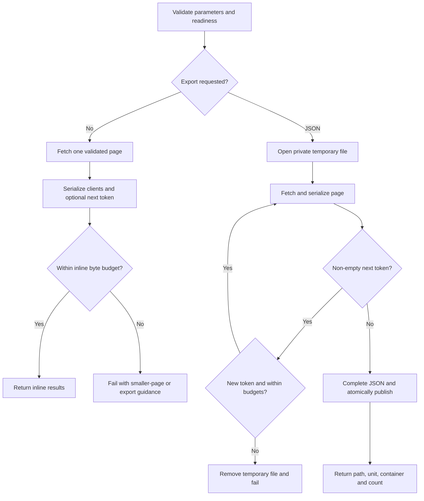

# OAuth client pagination and export design

## Context

See [proposal.md](proposal.md) for motivation and
[the listing spec](specs/oauth-client-listing/spec.md) for the action contract.

Before this change, `CommandLine.list_oauth_clients()` in `src/cli.py`
invoked the workload CLI once and discarded all response data except `items`.
The action handler returned a single `clients` string without client secrets
and confused an empty inventory with command failure.

Implementation verification confirmed `--page-size`, `--page-token`, and
JSON continuation metadata against the deployed `26.2.0` workload image.
The Hydra pagination source sets a maximum of 1000 items per page; the charm
passes requested sizes to Hydra rather than imposing a separate count cap.
Juju action results are passed as command-line arguments and have an
approximately 100 KB practical limit, not a portable exact payload ceiling.

Relevant references:

- [Hydra CLI pagination](https://www.ory.com/docs/hydra/cli/hydra-list-clients)
- [Canonical Hydra CLI implementation](https://github.com/canonical/hydra/blob/canonical/cmd/cmd_list_clients.go)
- [Ops action result constraints](https://canonical.com/juju/docs/ops/latest/reference/ops#ops.ActionEvent.set_results)
- [Juju file retrieval](https://canonical.com/juju/docs/juju-cli/latest/reference/juju-cli/list-of-juju-cli-commands/scp)

## Goals / Non-Goals

Goals are to share one validated page-fetching path between listing and
export, keep file handling out of action orchestration, and bound inline
output and temporary disk consumption.

Non-goals are new workload HTTP clients, changes to OAuth reconciliation,
background jobs, changes to leadership rules, and database schema changes.
There are no new tables, indexes, migrations, or dependencies.

## Decisions

### 1. Keep single-page listing as the default

Add optional action parameters: integer `page-size` defaulting to 100,
string `page-token` defaulting to empty, and optional string `export` with
only `json` accepted. An omitted export parameter selects inline results;
an explicitly empty value is invalid. Apply parameter validation both in
metadata where supported and in the action's domain handling. Respect Hydra
errors for unsupported sizes rather than silently reducing the requested
size. Verify the packaged workload's accepted upper bound during implementation.

Continue to return `clients` as a JSON string. Add `next-page-token` only
when non-empty; do not forward Hydra's `is_last_page`. Empty results are
successful. Export with a non-empty starting token is rejected before I/O.

Automatic inline aggregation would break the existing bounded-work default
and risk command-line overflow. A boolean export flag would make future
format selection awkward. A second completion flag would duplicate the
meaning of the token and could disagree with it.

### 2. Extend the existing workload CLI wrapper

In `src/cli.py`, introduce a typed page result holding validated OAuth client
models and an optional continuation token. The page fetcher passes token
values as separate command arguments without shell interpolation. Parse
`items` and `next_page_token`; require the documented response shape and
reject malformed present values. Treat absent or empty continuation as the
last page. Do not use page length to decide completion.

Use a domain exception for retrieval/validation failure rather than an empty
list sentinel. Do not include raw client JSON in exception messages or logs.
A shared serialization helper preserves the current `model_dump` aliases,
`exclude_none`, JSON mode, and client secret exclusion for both output modes.
Keep that helper in the domain layer, not duplicated in `charm.py`.

A direct Admin API client would also need pagination and error handling and
would add unnecessary transport code. Increasing the page size alone does
not solve inventories larger than the server's maximum page size.

### 3. Keep export operations in a dedicated domain helper

Introduce `src/oauth_client_listing.py` for the export service and shared
result serialization; this is a planned new module, not an existing API.
`src/charm.py` only checks readiness, delegates the selected mode, maps
failures to `event.fail`, and returns result metadata. Constants and domain
exceptions belong in `src/constants.py` and `src/exceptions.py`.

The exporter follows returned tokens sequentially and streams a JSON array
into a local file in the charm container. It serializes one page at a time;
it never accumulates the full inventory in memory. Track seen continuation
tokens to catch cycles, including tokens repeated after intervening pages.
Memory grows with one page plus token bookkeeping, not the complete client
payload. An empty inventory produces a valid `[]` file.

Keep the existing per-command timeout. Add a five-minute monotonic export
deadline; cap each fetch timeout by the remaining time and check the deadline
between pages. Do not blindly retry invalid or failed pages. A timeout or
repeated token aborts the export and removes incomplete output.

Returning content inline or constructing one giant list defeats the export
purpose. Parallel page fetching is inappropriate for opaque sequential tokens.



### 4. Publish one bounded private export per unit

Use a private directory under the charm root provided by Ops:
`oauth-client-exports/`, with directory permissions `0700`. The final file is
`oauth-clients.json`, with permissions `0600`. Create a unique temporary file
in the same directory using exclusive creation, enforce the 100 MiB byte
budget while writing, close the JSON array, flush and close the file, then
atomically replace the final file. Never accept a user-provided path.

Retain only the latest successful file per unit; replacement happens only
when the new file is complete. This means at most one completed file and one
in-progress file, each bounded by 100 MiB. Remove abandoned temporary files
on the next export attempt as well as cleaning up known failures. Unit
replacement may remove all files. Documentation must state that another
successful export overwrites the previous file and prompt retrieval is needed.

Return the absolute final `export-path`, the executing unit as `export-unit`,
`export-container=charm`, and integer `client-count`. No inline `clients` or
pagination fields are returned. Example retrieval with the returned values:

```shell
juju run hydra/leader list-oauth-clients export=json
juju scp --container charm hydra/0:/returned/absolute/path ./oauth-clients.json
```

`hydra/0` above is illustrative: always use `export-unit`, even if leadership
changes. Test actual `juju scp` retrieval on the supported Kubernetes/Juju
stack; do not assume the workload image contains SCP utilities.

Using the charm container avoids requiring file-transfer tools in the Hydra
image. Unique retained exports would accumulate files; durable storage would
introduce a new lifecycle and storage contract. A single replaceable file is
simple and bounded but requires operators to retrieve each export promptly.

### 5. Check encoded inline results before calling Juju

Budget 90 KiB across UTF-8 encoded flattened `key=value` arguments, including
`clients`, result keys, continuation metadata, and argument terminators.
Mirror the installed Ops transport's actual argument construction in tests;
JSON escaping and non-ASCII characters must be counted correctly. Also catch
an `OSError` from `set_results` so platform-specific lower limits produce
an actionable failure, not an uncaught exception. Never truncate or silently
change the requested page size.

A count-only limit cannot bound large client metadata. The 90 KiB value is
a conservative safety budget, not a claim about Juju's exact maximum.
Export result metadata stays small and is checked by the same mechanism.

## Risks / Trade-offs

- Concurrent client changes can affect pagination results. Document that
  exports are not transactional snapshots; tests use an unchanged inventory.
- Metadata may itself contain operator-provided sensitive information.
  Preserve existing fields, exclude the OAuth secret field, avoid logging
  payloads, and keep export permissions private. This is not a secret backup.
- Large exports occupy the hook for longer. Sequential fetches, a five-minute
  deadline, and disk limits bound resource consumption. Log only page/count
  progress and sanitized failure summaries, not clients or tokens.
- A lower platform argument limit can still reject a result below the budget.
  Catch transport errors and recommend smaller pages or file export.
- A fixed export path can be overwritten before download. Clearly document
  latest-only retention; successful replacement must be atomic.
- Abrupt termination can leave a temporary file. Clean abandoned files on the
  next export; never describe them as completed exports.

## Migration Plan

1. Obtain maintainer review of the new action metadata before implementation.
2. Implement and verify the action, including retrieval on Juju 3.6 and the
   packaged Hydra image. Preserve existing result fields and default page size.
3. Document pagination, JSON retrieval, budgets, retention, and the corrected
   empty-inventory behavior. No database or peer-state migration is needed.
4. Roll out through the normal charm release process. Older charms do not
   accept the new parameters; callers must wait for the upgraded revision.
5. Rollback restores the previous single-page action. Retrieve any needed
   export first; files are temporary and are not a rollback dependency.
